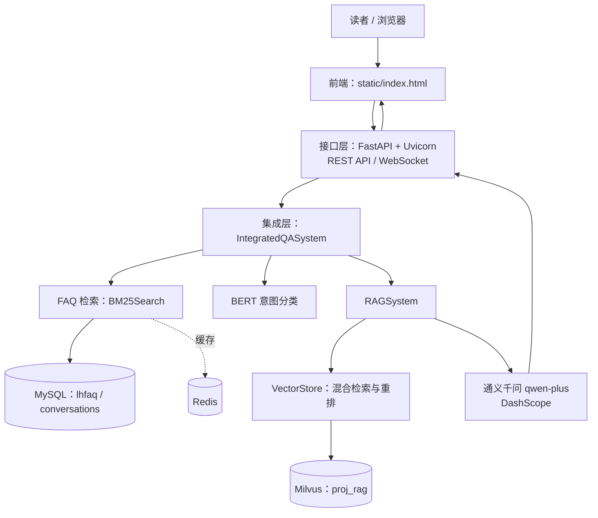

# 凌华图书馆 RAG 智能问答系统「凌小图」

> LH_LibRAG 是面向凌华图书馆业务场景的检索增强生成（RAG）问答系统。系统结合 MySQL FAQ 精确问答、BM25 关键词检索、Milvus 向量检索与大语言模型生成，为读者提供图书馆相关问题的智能咨询服务。

## 目录

- [项目简介](#项目简介)
- [项目展示](#项目展示)
- [主要功能](#主要功能)
- [系统架构](#系统架构)
- [技术栈](#技术栈)
- [数据存储设计](#数据存储设计)
- [核心问答流程](#核心问答流程)
- [检索增强策略](#检索增强策略)
- [项目结构](#项目结构)
- [运行环境与部署](#运行环境与部署)
- [接口与前端](#接口与前端)
- [GPU 与模型部署](#gpu-与模型部署)

## 项目简介

「凌小图」是一套面向图书馆业务的智能问答系统，目标是帮助读者查询馆藏相关信息、借阅规则、读者证办理、馆内服务及相关规定等内容。系统采用"FAQ 优先、RAG 兜底"的问答设计：能够由 FAQ 检索直接回答的问题优先返回已有答案；未能有效命中的问题，再进入 RAG 检索与大模型生成流程。

后端按三层划分：

1. **接口层**：使用 FastAPI 提供 HTTP API 与 WebSocket 流式问答能力。
2. **集成层**：由 `IntegratedQASystem` 统一协调问候语识别、FAQ 检索、意图分类和 RAG 问答。
3. **数据层**：使用 MySQL、Redis 和 Milvus 分别承载结构化 FAQ / 会话历史、缓存数据和向量检索数据。

## 项目展示

[<video src="https://github.com/user-attachments/assets/7699d5c9-e595-4be3-a8a7-6a222d1f51e5" controls></video>](https://github.com/user-attachments/assets/ac3fe689-6cae-428f-a439-204cb309b080)

展示gif：加载快，但清晰度低


## 主要功能

- **问候语处理**：对常见问候及告别语进行规则识别，并返回相应回复。
- **FAQ 问答**：从 MySQL 中读取结构化问答数据，通过 BM25 等关键词检索方式优先匹配常见问题。
- **意图分类**：使用本地 BERT 分类器区分通用知识类问题与图书馆专业咨询类问题，并据此选择后续处理路径。
- **混合检索与重排**：结合 BGE-M3 向量表示、Milvus 混合检索及 BGE-Reranker 重排相关候选内容。
- **多策略检索增强**：根据问题特点选择直接检索、假设问题检索（HyDE）、子查询检索或回溯问题检索。
- **大模型回答**：通过 DashScope 兼容接口调用通义千问 `qwen-plus` 生成答案。
- **流式输出**：通过 WebSocket 将生成过程中的内容逐步发送给前端。
- **会话历史**：将对话写入 MySQL `conversations` 表，并为后续多轮对话提供历史上下文。
- **Web 交互界面**：使用 `static/index.html` 提供前端页面。

## 系统架构



## 技术栈

| 类别 | 技术 / 组件 | 在项目中的用途 |
|---|---|---|
| 开发语言 | Python 3.11.9 | 后端及 RAG 业务逻辑 |
| Web 框架 | FastAPI | 提供后端接口 |
| ASGI 服务 | Uvicorn | 启动 FastAPI 应用，默认端口为 `8003` |
| 关系型数据库 | MySQL 8.0.43 | 存储 FAQ 问答数据与会话历史 |
| 缓存 | Redis 7.2 | 缓存检索相关数据，减少重复处理 |
| 向量数据库 | Milvus v2.4.10 | 存储文档向量并支持向量 / 混合检索 |
| 嵌入模型 | BGE-M3 | 为文本生成向量表示，支持稠密与稀疏检索能力 |
| 重排模型 | BGE-Reranker | 对初步召回的候选内容进行相关性重排 |
| 意图分类 | BERT 中文分类器 | 将用户问题分类为通用知识或图书馆专业咨询等类别 |
| 大语言模型 | 通义千问 `qwen-plus` | 基于检索上下文生成回答 |
| 模型服务接口 | DashScope OpenAI 兼容接口、OpenAI SDK | 调用大模型服务并支持流式生成 |
| 关键词检索 | `rank_bm25`、`jieba` | 中文分词及 BM25 关键词相关性检索 |
| 深度学习框架 | PyTorch `2.11.0+cu128` | 加载和运行本地模型 |
| 前端 | HTML / JavaScript | 提供轻量级 Web 问答界面 |

## 数据存储设计

### 1. MySQL

数据库：`lhlib_kg`

| 表名 | 主要字段 | 作用 |
|---|---|---|
| `lhfaq` | `id`、`category`、`question`、`answer` | 保存结构化 FAQ 问答对，作为 BM25 检索的数据来源 |
| `conversations` | `id`、`session_id`、`question`、`answer`、`timestamp` | 保存会话中的问题与回答，用于历史记录和多轮对话上下文 |

### 2. Redis

Redis 用于缓存检索相关数据，避免重复加载和构建。

### 3. Milvus

- **版本**：v2.4.10
- **集合名称**：`proj_rag`
- **用途**：保存文档切片及其向量表示，为 RAG 流程提供语义检索和混合检索能力。
- **向量模型**：BGE-M3
- **检索方式**：结合稠密向量与稀疏向量进行候选召回，再由 BGE-Reranker 对候选结果重排。

## 核心问答流程

```text
用户提交问题
    │
    ▼
问候语识别 ── 命中 ──> 返回预设回复
    │ 未命中
    ▼
BM25 FAQ 检索（基于 MySQL 中的 lhfaq 数据）
    │
    ├── 达到命中条件 ──> 返回 FAQ 答案
    │
    └── 未达到命中条件
             │
             ▼
        BERT 意图分类
             │
             ├── 通用知识类 ──> 直接调用大模型回答
             │
             └── 图书馆专业咨询类
                       │
                       ▼
               选择检索增强策略
                       │
                       ▼
               BGE-M3 编码 / 查询改写
                       │
                       ▼
               Milvus 混合检索召回候选内容
                       │
                       ▼
               BGE-Reranker 相关性重排
                       │
                       ▼
               组合检索上下文、提示词和对话历史
                       │
                       ▼
               调用 qwen-plus 生成回答
                       │
                       ▼
               WebSocket 流式返回前端
                       │
                       ▼
               保存问答记录至 conversations
```

## 检索增强策略

系统可根据问题特点选择不同检索增强策略，以改善查询表达与知识库内容之间的匹配效果。

| 策略 | 基本思路 | 适用问题类型 |
|---|---|---|
| 直接检索 | 使用用户原始问题进行检索 | 问题明确、关键词较具体，例如开放时间或借阅期限 |
| 假设问题检索（HyDE） | 先生成假设性文本，再使用生成文本辅助检索 | 原始提问较抽象，或与知识库原文的表达差异较大 |
| 子查询检索 | 将复杂问题拆分为多个子问题，分别检索后汇总结果 | 一个问题包含多个查询目标或条件 |
| 回溯问题检索 | 对原问题进行改写、归纳或分解，再检索相关内容 | 提问较复杂、口语化，或直接检索效果不佳的场景 |

## 项目结构

```text
LH_LibRAG/
├── app.py                    # FastAPI 应用入口与接口定义
├── new_main.py               # IntegratedQASystem 集成入口
├── static/
│   └── index.html            # Web 前端页面
├── base/
│   ├── config.py             # 配置加载
│   └── logger.py             # 日志配置
├── mysql_qa/
│   ├── db/mysql_client.py    # MySQL 访问封装
│   ├── cache/redis_client.py # Redis 访问封装
│   ├── retrieval/bm25_search.py  # FAQ 关键词检索
│   └── utils/preprocess.py   # 文本预处理
└── rag_qa/
    ├── core/
    │   ├── new_rag_system.py # RAG 问答流程编排
    │   ├── vector_store.py   # 向量检索与重排
    │   ├── strategy_selector.py  # 检索策略选择
    │   └── query_classifier.py   # BERT 意图分类
    ├── models/               # 本地模型（BGE-M3、BGE-Reranker）
    ├── edu_document_loaders/ # 文档解析（PDF / 图片 OCR）
    └── edu_text_spliter/     # 文本切分
```

## 运行环境与部署

### 环境要求

- Python 3.11.9
- MySQL 8.0.43，已创建 `lhlib_kg` 数据库及所需数据表
- Redis 7.2 服务可连接
- Milvus v2.4.10 服务可连接，已创建 `proj_rag` 集合并导入向量数据
- 可访问 DashScope 服务的网络环境及有效 API Key
- 若使用 GPU 运行本地模型，需要安装与显卡驱动及 CUDA 运行环境兼容的 PyTorch

### 1. 获取代码并创建虚拟环境

```bash
git clone <your-repository-url>
cd <project-directory>

python -m venv .venv
```

激活虚拟环境（Windows PowerShell）：

```powershell
.\.venv\Scripts\Activate.ps1
```

### 2. 安装依赖

```bash
pip install -r requirements.txt
```

### 3. 配置依赖服务与模型

启动应用前，请确认以下配置已填写并能正常连接：

- MySQL 连接地址、端口、用户名、密码及数据库名 `lhlib_kg`
- Redis 连接地址、端口、认证信息（如启用）
- Milvus 地址、端口及集合名称 `proj_rag`
- DashScope API Key、兼容接口地址及模型名 `qwen-plus`
- BGE-M3、BGE-Reranker、BERT 分类模型已下载到本地对应路径

配置通过 `base/config.py` 与 `config.ini` 管理。`config.ini` 已加入 `.gitignore`，真实凭据请通过环境变量或本地文件保存，不要提交到公开仓库。

### 4. 访问应用

- 后端地址：`http://127.0.0.1:8003`
- FastAPI 接口文档：`http://127.0.0.1:8003/docs`
- 前端入口：`static/index.html`

## 接口与前端

后端基于 FastAPI 提供问答和会话相关接口，包括普通问答、流式问答、会话创建、历史记录查询、数据源信息和健康检查等，路由定义见 `app.py` 或 `/docs`。

- **REST API**：适合普通请求与响应，例如提交问题、创建会话、查询历史记录和健康状态。
- **WebSocket**：适合保持客户端与服务端的双向连接，逐步推送大模型生成内容，实现流式显示。
- **会话历史**：使用 `session_id` 关联同一会话中的问题和回答，供历史展示或多轮问答使用。

## GPU 与模型部署

| 模型 / 组件 | 设备 | 部署说明 |
|---|---|---|
| BGE-M3 | GPU（CUDA） | 检索主路径，fp16 加载，显存约 1.1GB |
| BGE-Reranker | CPU | 每查询只重排 2~3 个候选，毫秒级 |
| BERT 分类器 | CPU | 轻量短文本任务 |
| qwen-plus | 云端 API | DashScope，不占本地资源 |

项目使用 PyTorch `2.11.0+cu128`（CUDA 12.8 构建）。本机内存偏紧时采用 CPU＋GPU 混合部署以平衡资源占用。
